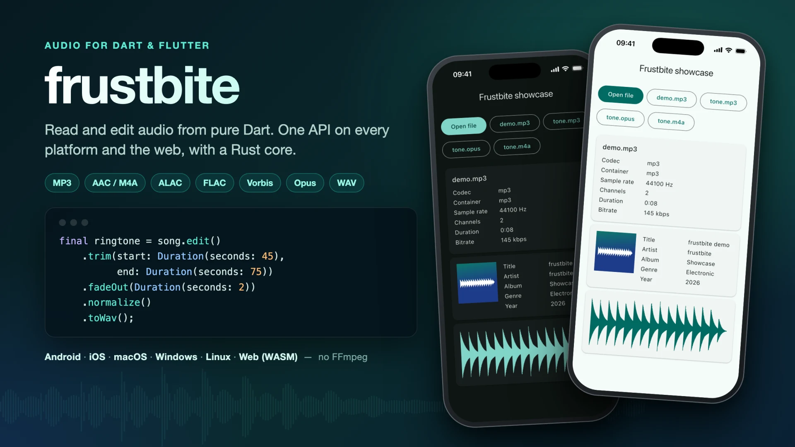
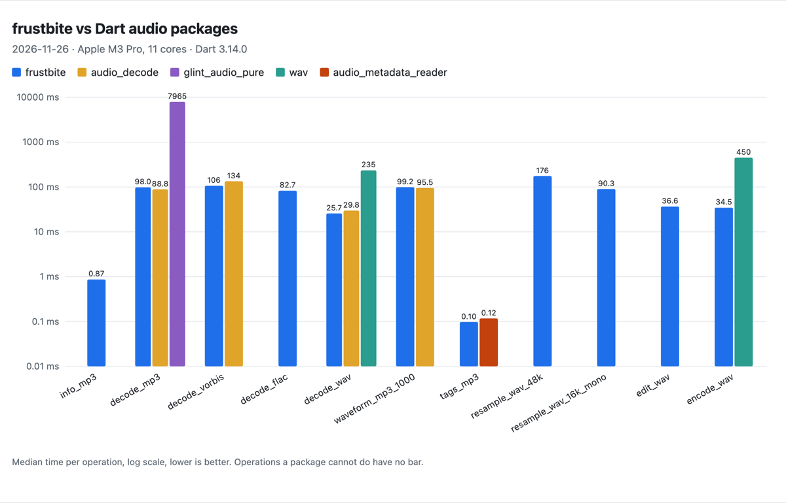

# Frustbite

[](https://github.com/sb-dor/frustbite/actions/workflows/ci.yaml)
[](LICENSE)
[](https://sb-dor.github.io/frustbite/)
[](https://pub.dev/packages/frustbite)

<p align="center">
  
</p>

**Read and edit audio from pure Dart: info, tags, cover art, waveforms, PCM,
and a lazy editing pipeline with WAV output, powered by a Rust core through FFI
and WebAssembly.**

- Decodes MP3, AAC-LC (M4A, ADTS), ALAC, FLAC, Vorbis, Opus and WAV
- Waveforms (peak or RMS) with bounded memory, even for hour-long files
- Tags and embedded cover art
- Editing in one native call: trim, join with crossfades, mix, fade, normalize,
  resample, mono/stereo, silence trimming and detection; save as 16/24-bit or
  float WAV
- Async: `waveformAsync`, `decodeAsync`, `renderAsync` and friends run on a
  background isolate
- Android, iOS, macOS, Linux, Windows and the web (dart2js and dart2wasm)
- Pure Rust core with no FFmpeg and no C codecs

Read the [documentation](https://sb-dor.github.io/frustbite/) or see the
[package README](packages/frustbite/README.md) for API usage and the
[roadmap](packages/frustbite/README.md#roadmap).

Try it in the minimal [Flutter showcase](packages/showcase/README.md), and see
how it compares with other Dart audio packages in the
[benchmarks](packages/benchmark/README.md).

## Why frustbite

Playing audio in Flutter is easy; reading its tags, drawing its waveform,
cutting it or converting it is not. The usual answer has been FFmpeg, whose
common Flutter wrapper, FFmpegKit, was retired in 2025. FFmpeg adds tens of
megabytes, does not run on the web and is LGPL or GPL. frustbite does these
jobs with one Dart API on every platform and the web, a native library of about
2 to 4 MB, an MIT license and no dependencies on other Dart packages. People
use it for:

- waveforms and durations of voice messages;
- tags, cover art and seek-bar waveforms in podcast and music apps;
- the 16 kHz mono WAV that speech recognition models such as Whisper expect;
- trimming, fades and normalization before an upload, or ringtones;
- audio editors: joins with crossfades, mixing, silence removal;
- playing Opus or Vorbis on iOS, by converting to WAV first;
- the same processing in a Dart backend.

More in [Why frustbite](packages/frustbite/README.md#why-frustbite).

## What it does not do

frustbite does not play or record audio, and it writes WAV only for now. For
playback, hand the bytes from `toWav()` to a player package such as
`audioplayers`, `just_audio` or `media_kit`. See
[What frustbite does not do](packages/frustbite/README.md#what-frustbite-does-not-do).

WAV is sound with no compression: about 10 MB a minute, but it loses nothing
and plays on almost every device. FLAC (lossless, about half the size) and Opus
(lossy, the smallest) come next. MP3 and AAC output wait for a pure-Rust encoder
with a fitting license. What each format is and why, in
[Output formats](packages/frustbite/README.md#output-formats-wav-flac-opus-mp3-and-aac).

## Showcase

The [Flutter showcase](packages/showcase/README.md), pictured at the top, opens
an audio file or a bundled sample and shows its stream info, tags, cover art and
waveform. Its editor trims, fades, normalizes, resamples and converts to mono,
plays the source and the result, and saves the result as WAV. Playback in the
showcase uses `audioplayers`; the frustbite package does not depend on it.

## Benchmarks



Headline numbers (180 s stereo input, Apple M3 Pro, median of 10 runs):

- Decode WAV: 25.7 ms against 234.9 ms for the pure-Dart `wav` package (9.13x)
- Decode MP3: 98.0 ms against 7964.9 ms for the pure-Dart `glint_audio_pure` (81.29x)
- Decode MP3: 0.91x against `audio_decode` (88.8 ms), which is also native code
- Read and write a WAV: 34.5 ms against 449.7 ms for `wav` (13.04x); resample
  180 s of stereo to 48 kHz: 175.7 ms

Against native C decoders frustbite is roughly on par, and slower on MP3
decode. Methodology and every row are in the
[benchmark README](packages/benchmark/README.md).

## Documentation

```bash
cd docs
npm install
npm run docs:dev
```

Blume builds the production site into `docs/dist/` with
`cd docs && npm run docs:build`.

See [AGENTS.md](AGENTS.md) for the repository layout and development commands.

## License

See [LICENSE](LICENSE). Third-party notices are in
[THIRD_PARTY_LICENSES.md](THIRD_PARTY_LICENSES.md); note that the bundled
`symphonia` decoders are MPL-2.0, and that file says where to get their source.
