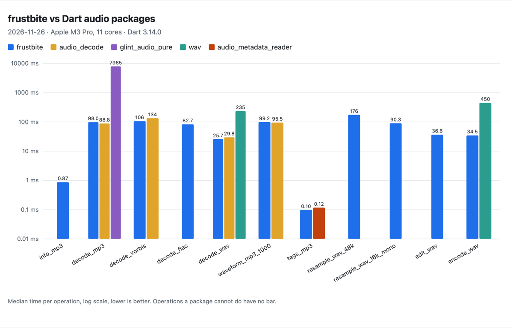

# frustbite benchmarks

frustbite (Rust core, pure-Dart API) against the existing Dart audio packages.
Speedup is `baseline time / frustbite time`: above 1x frustbite is faster,
below 1x it is **slower**. Rows where frustbite is slower are kept as measured.

- Date: 2026-11-24
- Machine: Apple M3 Pro, 11 cores (macOS, arm64)
- Dart: 3.14.0 (stable)
- Input: 180 s, 44.1 kHz stereo synthetic music-like signal (chord tones, pink
  noise, 2 Hz beat envelope). mp3 is CBR 192 kbps with ID3v2 tags and a
  500x500 JPEG cover; the other files are ogg (Vorbis), flac and wav (s16).



## Results

Median of 10 runs after 2 warm-up runs, in milliseconds (raw numbers in
`benchmark_results.json`).

| Operation | frustbite | baseline | Speedup |
| --- | --- | --- | --- |
| info (mp3) | 0.96 ms | — (no baseline) | — |
| decode mp3 | 95.4 ms | `audio_decode`: 83.2 ms | 0.87x |
| decode mp3 | 95.4 ms | `glint_audio_pure`: 7955.9 ms | 83.39x |
| decode Ogg Vorbis | 106.7 ms | `audio_decode`: 124.7 ms | 1.17x |
| decode FLAC | 78.3 ms | — (no baseline supports FLAC) | — |
| decode WAV | 24.9 ms | `wav`: 225.6 ms | 9.05x |
| decode WAV | 24.9 ms | `audio_decode`: 29.2 ms | 1.17x |
| waveform mp3, 1000 buckets | 93.1 ms | `audio_decode` decode + Dart bucket loop: 88.7 ms | 0.95x |
| tags + cover (mp3) | 0.10 ms | `audio_metadata_reader`: 0.09 ms | 0.94x |

Reading the table honestly: against `audio_decode`, which is also native code,
frustbite is roughly on par. It is slower on mp3 decode (0.87x) and waveform
(0.95x), faster on Vorbis (1.17x) and WAV (1.17x). Against the pure-Dart decoders the
gap is large (83x for mp3, 9x for WAV). On tags, `audio_metadata_reader` is
marginally faster (0.94x, within timer noise at this scale).

## Baselines

All are dev-time dependencies of this benchmark package only; none is shipped
with or affects the licence of frustbite.

| Package | Version | Licence | Kind | Returns |
| --- | --- | --- | --- | --- |
| [`audio_decode`](https://pub.dev/packages/audio_decode) | 1.3.6 | MIT | C (minimp3, stb_vorbis) via FFI, build hook | `Int16List` interleaved; `toFloat32()` conversion is included in the timing |
| [`glint_audio_pure`](https://pub.dev/packages/glint_audio_pure) | 0.7.0 | MIT | pure Dart | `Float64List` interleaved (mp3 only) |
| [`wav`](https://pub.dev/packages/wav) | 1.5.0 | Apache-2.0 | pure Dart | `List<Float64List>`, one per channel (not interleaved) |
| [`audio_metadata_reader`](https://pub.dev/packages/audio_metadata_reader) | 1.8.1 | MIT | pure Dart | `AudioMetadata` incl. cover pictures |

All four are Dart-VM usable (none depends on Flutter) and were published within
the last 18 months (`wav` last in July 2025). frustbite returns interleaved
`Float32List`.

## Methodology

- Run with `dart run bin/main.dart` (JIT VM, default flags). `--quick` runs
  each case once with no warm-up as a smoke test and writes nothing.
- Each case: 2 untimed warm-up runs, then 10 timed runs; the **median** is
  reported. Timing is a `Stopwatch` around one operation. Cases are structured
  with `benchmark_harness`'s `BenchmarkBase` (`setup`/`run`/`teardown`) but
  timed by our own loop, because the harness's `measure()` returns a mean over
  a fixed 2 s window, which is a handful of samples for the slow cases.
- Sources are preloaded into memory as bytes before timing, except `tags_mp3`
  (see below), which reads the file.
- frustbite: every measured run opens a fresh `Frustbite.fromMemory`,
  performs the operation and `dispose()`s it, so cached `info`/`tags` never make
  repeat runs free. Open/dispose cost is included.
- Build: frustbite is a release native build compiled from source
  (`local_build: true`, cargo release profile with fat LTO, opt-level 3). The
  baselines use their own build hook or default settings (`audio_decode`
  compiles its C through its own hook; the others are plain Dart).
- `waveform`: frustbite `waveform(buckets: 1000)` (peak mode, merged channels)
  against `audio_decode` mp3 decode followed by a Dart loop. Both compute
  peak-per-bucket, but they are not literally the same algorithm: the baseline
  computes exact per-bucket peaks over the raw samples, while frustbite
  summarises 256-frame blocks and then maps those blocks onto buckets.
- `tags`: frustbite `Frustbite.fromFile(path)` then `tags` + `cover`, opened
  fresh per operation, against `audio_metadata_reader` reading the same file.
  Both sides do file I/O.
- Warm-up: the pure-Dart baselines get only 2 JIT warm-up runs, which may
  understate their steady-state speed.

Caveats that favour or disfavour either side:

- `tags_mp3`: both sides read the same file from disk (warm OS page cache) and
  extract the cover. At sub-millisecond scale the result is sensitive to timer
  noise; treat 0.94x as a tie.
- `info_mp3` has no baseline: no listed package exposes a comparable header
  scan (`audio_decode` has `audioInfo`, but the brief's table does not pair it
  with this case).
- `glint_audio_pure` decodes MPEG-1 Layer III only and returns doubles; it is
  included because it is the pure-Dart option.
- Numbers vary a few percent between runs; small-ms cases vary more.
- Single machine, single synthetic input; real-world files may differ.

## Reproduce

```sh
./tool/generate_inputs.sh      # needs ffmpeg with libmp3lame (inputs/ is gitignored)
dart run bin/main.dart         # full run: writes benchmark_results.json, updates chart.html
dart run bin/main.dart --quick # smoke test
```

`chart.html` embeds the results JSON, so it renders when opened directly from
disk (no server, no CDN). `main.dart` refreshes the embedded JSON after a full
run; `chart.png` is exported from it.
