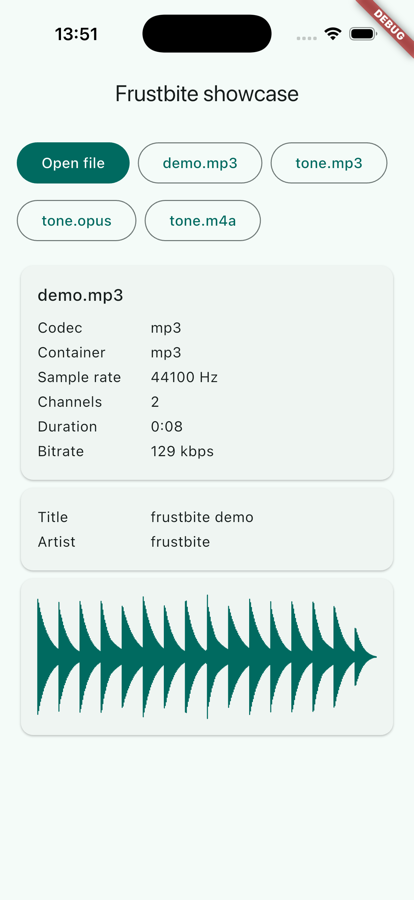

# frustbite

[](https://github.com/sb-dor/frustbite/actions/workflows/ci.yaml)
[](https://github.com/sb-dor/frustbite/blob/main/LICENSE)
[](https://sb-dor.github.io/frustbite/)
<!-- Enable after the first pub.dev release; the badge shows "not found" before that.
[](https://pub.dev/packages/frustbite)
-->

Read audio from pure Dart: stream info, tags, cover art, waveforms and decoded
PCM. A Rust crate does the work through FFI and Dart build hooks on native
platforms and through WebAssembly on the web.

Stage 1 is read-only. Editing and encoding are on the [roadmap](#roadmap).

Full documentation: <https://sb-dor.github.io/frustbite/>.

## Showcase

The [Flutter showcase](https://github.com/sb-dor/frustbite/tree/main/packages/showcase)
shows info, tags and a waveform:



## Install

```yaml
dependencies:
  frustbite: ^0.0.2
```

The build hook downloads the prebuilt native library for your platform from the
matching GitHub Release and verifies its SHA-256 hash. Supported platforms:
Android, iOS, Linux (glibc 2.35 or newer), macOS, Windows and the web.

## Platform requirements

The prebuilt binaries target these minimum OS versions:

| Platform | Minimum |
| --- | --- |
| iOS | 16.0 |
| macOS | 13.0 |
| Android | API 30 (Android 11) |
| Linux | glibc 2.35 (Ubuntu 22.04, Debian 12) |

A Flutter app has to raise its own minimums to match, or the build fails or the
app does not load the library:

- **iOS**: in `ios/Podfile` set `platform :ios, '16.0'`, and set the iOS
  Deployment Target of the Runner target to 16.0 in Xcode.
- **macOS**: in `macos/Podfile` set `platform :osx, '13.0'`, and set
  `MACOSX_DEPLOYMENT_TARGET = 13.0` (Xcode: macOS Deployment Target).
- **Android**: in `android/app/build.gradle(.kts)` set `minSdk = 30`
  (`minSdkVersion 30` in older Groovy files).

For other minimums, build from source (see [Build options](#build-options)).

## Quick start

```dart
import 'package:frustbite/frustbite.dart';

void main() {
  final audio = Frustbite.fromFile('song.mp3');
  try {
    final info = audio.info;
    print('${info.codec.name}, ${info.sampleRate} Hz, ${info.duration}');
    print('${audio.tags.artist} - ${audio.tags.title}');

    final waveform = audio.waveform(buckets: 200);
    print(waveform.channel(0).length); // 200 amplitudes in [0, 1]

    final pcm = audio.decode(); // interleaved Float32List
    print(pcm.frames);
  } finally {
    audio.dispose();
  }
}
```

A runnable version lives in [`example/frustbite_example.dart`](example/frustbite_example.dart):

```sh
dart run example/frustbite_example.dart song.mp3
```

Use `Frustbite.fromMemory(bytes)` on every platform, including the web. The
container is detected from the content; the optional `format:` argument is only
an advisory hint, and a wrong hint is not an error.

## Formats

| Codec | Containers |
| --- | --- |
| MP3 | MP3 |
| AAC-LC | MP4/M4A, ADTS |
| ALAC | MP4/M4A |
| FLAC | FLAC |
| Vorbis | Ogg |
| Opus | Ogg, WebM/Matroska |
| PCM | WAV |

Known limitations:

- **HE-AAC** (HE-AAC and HE-AACv2) is unsupported. It throws
  `UnsupportedFormatException` when SBR is signalled explicitly. Implicit-SBR
  and ADTS HE-AAC cannot be detected when the file is opened and may decode as
  the AAC-LC core.
- **Opus in MP4** is unsupported in stage 1. Opus in Ogg and in WebM/Matroska
  is supported.
- **WebM** gives no tags (the tag library has no Matroska support). Its
  duration may include up to one packet of tail padding.
- **m4a and ADTS**: `totalFrames` includes the 1024-frame AAC priming. It is
  exact for wav, flac, mp3 with a LAME/Xing header, vorbis, ogg-opus and alac;
  mp3 without that header is counted from the packets.
- **ID3v1 text** is decoded as Latin-1, so non-Latin titles in ID3v1-only files
  (for example CP1251 Cyrillic) show as mojibake. ID3v2 tags are unaffected.

## Async

`waveformAsync` and `decodeAsync` run on a background isolate on native
platforms, so the UI isolate stays free. On the web they only defer the work to
a later event-loop turn; it still runs on the main thread.

```dart
final waveform = await audio.waveformAsync(buckets: 200);
```

## Web

Download `frustbite.wasm` from the GitHub Release matching the package version
and put it in the web root, then initialize before first use:

```dart
await Frustbite.initialize();
final audio = Frustbite.fromMemory(bytes);
```

`fromFile` throws `UnsupportedError` on the web. On pages whose CSP forbids
`unsafe-eval`, a Rust panic inside wasm under dart2wasm escapes as a raw
JavaScript error instead of `UnknownFrustbiteException`.

## Build options

By default the prebuilt library is downloaded. Add user defines to your
application's `pubspec.yaml` to build from source instead (needs a Rust
toolchain):

```yaml
hooks:
  user_defines:
    frustbite:
      local_build: true
      # Optional, implies a source build: compile only these codecs.
      # Names: aac, alac, flac, mp3, opus, vorbis, wav.
      formats: [mp3, wav]
```

Source builds work **only with a git dependency**: the Rust crate is not
included in the package on pub.dev, and pub clones the whole repository for a
git dependency. Without it the build fails with a `StateError` that says so.

```yaml
dependencies:
  frustbite:
    git:
      url: https://github.com/sb-dor/frustbite
      path: packages/frustbite
```

With no user defines the hook downloads prebuilt binaries, which works with the
pub.dev package.

## Performance

On an Apple M3 Pro, 180 s of 44.1 kHz stereo mp3 decodes in 95 ms. That is
roughly on par with the native `audio_decode` (0.87x) and 83x faster than the
pure-Dart `glint_audio_pure`. See [`packages/benchmark`](https://github.com/sb-dor/frustbite/blob/main/packages/benchmark/README.md)
for the full table, including the rows where Frustbite is slower.

## Roadmap

1. **Reading (this release).** `fromFile`/`fromMemory`, `info`, `tags`,
   `cover`, `waveform`, `decode` and their async variants; web support.
2. **Editing.** `trim`, `concat`, `gain`, `normalize`, `fadeIn`/`fadeOut`,
   `resample`, `toMono`/`toStereo`, as a lazy pipeline run in one native call.
3. **Writing.** wav, flac and opus encoders, `encode` and `saveToFile`, and
   tag writing without re-encoding.
4. **Large files and CLI.** Streaming decode as a `Stream` of PCM chunks and a
   `frustbite info|waveform|convert|trim` command line tool.
5. **Publishing.** First stable release with prebuilt binaries for all targets.

## License

See [LICENSE](LICENSE). Third-party notices are in
[THIRD_PARTY_LICENSES.md](THIRD_PARTY_LICENSES.md); note that the bundled
`symphonia` decoders are MPL-2.0, and that file says where to get their source.

## Acknowledgements

Repository structure, build hooks and release flow adapted from
[hawkkiller/pixer](https://github.com/hawkkiller/pixer) (MIT, © 2026 Michael
Lazebny).
